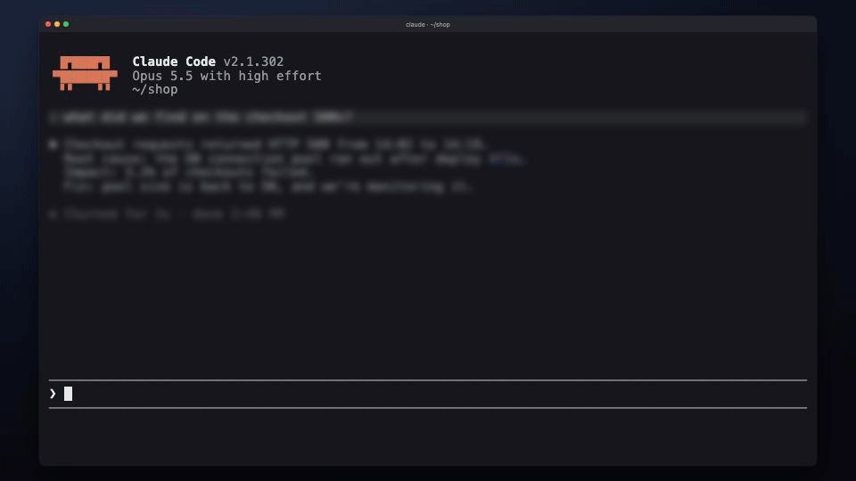

# draftgate

draftgate holds a message your Claude Code agent is about to send to Jira, Slack, Linear or GitHub
and shows it in a window, drawn the way that destination will draw it. You can edit it, then approve
or reject it. Nothing is sent until you approve, and every edit you make is kept, so you can teach
the agent to write the next draft the way you would. The window also says who will read the message
when that is not obvious: a customer on a Jira service desk, or anyone at all on a public GitHub
repository.



macOS 26 or newer only. You need Claude Code, Apple's Command Line Tools
(`xcode-select --install`) and bun, which the install script adds if it is missing.

## Install

In a terminal:

```sh
curl -fsSL https://raw.githubusercontent.com/Jakuboola/draftgate/stable/install.sh | sh
```

Or, in Claude Code, `/plugin marketplace add Jakuboola/draftgate` and then
`/plugin install draftgate@draftgate`. That way needs bun installed first
(`curl -fsSL https://bun.sh/install | bash`). bun's installer may ask you to add `~/.bun/bin` to
your PATH; draftgate finds it there without that.

The script checks the Command Line Tools and Claude Code, installs bun if it is missing, and
installs the plugin with Claude Code's own `claude plugin` commands. From then on, new sessions
review every Jira, Slack, Linear and GitHub send tool draftgate knows. Then run `/draftgate:setup`
in Claude Code to choose which of your tools it reviews.

To update, run the script again, or turn on auto-update for the `draftgate` marketplace in
`/plugin`. Tools you added in `/draftgate:setup` stay reviewed after an update.

## Commands

`draftgate` runs inside Claude Code, which puts it on the PATH of its Bash tool. Ask Claude Code to
run it, for example "run `draftgate doctor`".

```
/draftgate:setup      choose which tools to review; run it again after adding a connector
draftgate help        the commands; draftgate <command> --help gives a command's options
draftgate doctor      check the install: hooks on, every send tool covered
draftgate digest      read the review log: outcomes, warnings, what reviewers edited
draftgate version     the installed version
draftgate uninstall   take draftgate's settings entry and files out (below)
```

## Teach your agent from your edits

Each draft you edit is logged as the agent wrote it and as you sent it. `draftgate digest` lists
those edits, newest first, and counts per destination how many drafts went out unedited. That is
the record of what your agent keeps getting wrong.

To turn it into better drafts, paste this into Claude Code now and then:

> Run `draftgate digest --since-last --mark`, read how I edited your drafts, and update your
> instructions so you write the next ones that way.

`--since-last` shows only the reviews since the previous `--mark`, so each round reads new edits
once.

## What it reviews

Calls to MCP tools. A message sent with `curl` or a script never reaches draftgate;
[docs/gating-your-own-sends.md](docs/gating-your-own-sends.md) shows how to make one reviewable.

These sessions run no hooks, so their messages go out unreviewed:

- started with `--bare`, `--safe-mode`, or a `--settings` file that turns hooks off;
- started with `CLAUDE_CODE_SIMPLE` or `CLAUDE_CODE_SAFE_MODE` set.

`draftgate doctor` checks your settings files, not a session's flags.

draftgate catches an agent's mistakes, not an agent working against you: anything running as your
user can remove the hook or send around it.

## What it keeps, and what it sends

**The log.** Each review is a line in `~/.draftgate/audit.jsonl`, which draftgate creates readable
by you only. Each line holds the full text of the message as drafted and as sent, where it was
going, the outcome and your reason for a rejection. Rejected and timed-out drafts are logged too.
`draftgate digest` summarises it. Lines older than 60 days are dropped whenever draftgate logs a
review or you run `draftgate digest` or `draftgate doctor`; `auditRetentionDays` changes the 60, and
`0` keeps everything. To turn the log off, set `DRAFTGATE_AUDIT_LOG` to an empty string in the `env`
block of `~/.claude/settings.json`.

**The release check.** At most once a day, after a review, draftgate runs `git ls-remote` against
its GitHub repository. It sends no credentials and nothing about your messages. When a newer
release exists, the next review says so and names the command that updates the plugin.
`"releaseCheck": false` turns the check off; GitHub's Watch -> Custom -> Releases tells you
instead.

**The deadline.** A review nobody answers within `reviewSeconds` (20 minutes by default) is denied
like a rejection, and nothing is sent. The longest is an hour; a longer setting is held to it.

All three settings live in `~/.draftgate/config.json`:

```json
{ "version": 1, "reviewSeconds": 1800, "auditRetentionDays": 7, "releaseCheck": false }
```

## Uninstall

In Claude Code, in this order:

1. Ask it to run `draftgate uninstall`. It takes the entry `/draftgate:setup` may have added out of
   your Claude Code settings, then asks before deleting `~/.draftgate`: the log and your draftgate
   settings. It names what it leaves: a log you moved elsewhere and the
   `settings.json.draftgate-backup-*` copies of your Claude Code settings.
2. Run `/plugin uninstall draftgate@draftgate`, which removes the plugin, its hook and the
   `draftgate` command, then `/plugin marketplace remove draftgate`.

## Development

A checkout needs bun 1.4.0 or newer, the first that reads its `bun.lock`.

```sh
git clone https://github.com/Jakuboola/draftgate && cd draftgate
bun install
bun test                 # opens no window
bun run typecheck
bun run surface:probe    # the window, rendered for real
bun run surface:e2e      # CLI -> window -> click -> payload
bun run surface:host     # the native host's guarantees
bun cli/src/main.ts review --dest jira --in docs/examples/jira-payload.json
```

A release is `bun run release` on `main`, at the version in `plugin/.claude-plugin/plugin.json`
(bump it first): it builds the window, runs `surface:probe` and `surface:e2e` on it, tags `main`
and commits the window and the plugin tree onto `stable`, the branch installs follow.
`bun run build:plugin` assembles the same plugin tree locally, for `claude --plugin-dir`.
Run the `surface:*` verifiers one at a time. `.claude/CLAUDE.md` holds the module map, the commands
and the counts each run must print; it and `.claude/rules/` hold the rules.

`bun run --cwd tools/demo-video gif` re-renders the demo above: the window from its own components,
the terminal from a committed recording (run `bun install --cwd tools/demo-video` first). It uses
Remotion: source-available, free for individuals, and a contributor at a company of four or more
needs a Remotion licence to re-render.

## Licence

MIT (`LICENSE`). `docs/NOTICE` credits third-party material, and the built window carries
`THIRD_PARTY_NOTICES`.
